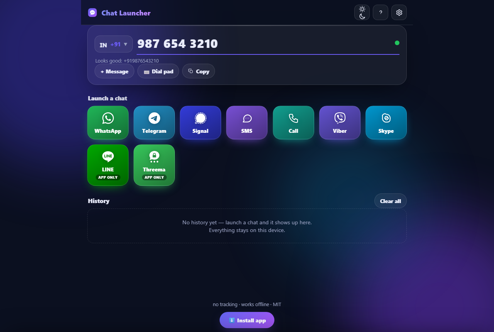
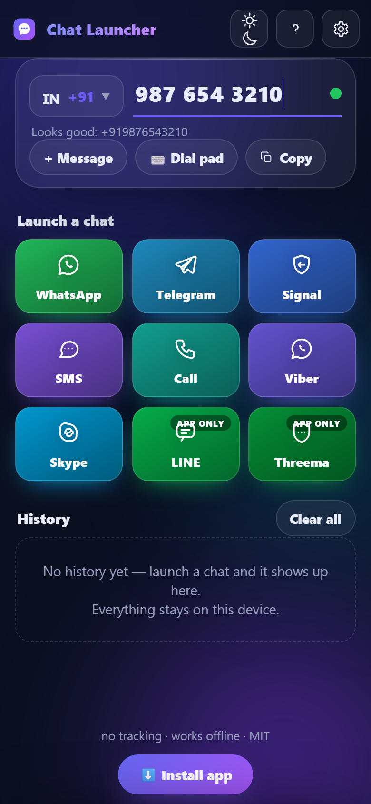

# 💬 Chat Launcher

**Type a phone number → tap an app → start chatting.**

Chat Launcher opens a number's chat directly in WhatsApp, Telegram, Signal, SMS, Viber, Skype and more — no contacts app, no copy-pasting, no saving the number first. It's a zero-dependency, offline-first PWA: nothing is tracked, nothing leaves your device, and it installs as a real app on Android, iOS and desktop.

<p align="center">
  
</p>
<p align="center">
  
</p>

## Why

Every messenger hides chat-by-number behind the same dance: save the contact, reopen the app, find them, chat — for a one-time conversation with a plumber or a marketplace seller. Chat Launcher collapses that to *number in, chat open*. It also shines when you already have a number in front of you (a listing, a support page, a message): paste `+91 98765 43210` and the country is detected automatically.

## Features

- 🚀 **9 launch targets** — WhatsApp, Telegram, Signal, SMS, Phone call, Viber, Skype, LINE, Threema
- 🌍 **Country picker** with ~230 dial codes and emoji flags; your choice is remembered
- 🧠 **Smart paste** — `+44 20 7946 0958`, `0049…`, `+1 (555) …` are parsed and matched to the country by longest prefix
- ✍️ **Preset message** — pre-fill text where the platform supports it (WhatsApp, SMS)
- 🕘 **History** — recent numbers with usage counts, pin favourites, rename, one-tap refill
- ⌨️ **Dial-pad mode** for one-handed touch input
- ⌨️ **Keyboard shortcuts** — `Enter` launch, `Ctrl+1–9` app picker, `/` focus, `d` dial pad, `t` theme, `?` help
- 🌗 **Dark / light / system theme** with animated transitions
- 🧩 **Reorder, hide or show tiles** in settings
- 📲 **Installable PWA** — service-worker precache, offline from second visit, update toast, share-target support (share a number from any app into Chat Launcher)
- 🔗 **Deep links** — `?number=+15551234567&text=hi&app=whatsapp` opens pre-filled
- ♿ **Accessible** — keyboard navigable, aria-live validation, `prefers-reduced-motion` honoured

## Platform support

| Target | Opens chat by number | Pre-filled message | Deep link |
|---|---|---|---|
| WhatsApp | ✅ | ✅ | `https://wa.me/<number>?text=…` |
| Telegram | ✅ | — | `https://t.me/+<number>` |
| Signal | ✅ | — | `https://signal.me/#p/+<number>` |
| SMS | ✅ | ✅ | `sms:+<number>?body=…` (iOS: `&body=`) |
| Phone call | ✅ | — | `tel:+<number>` |
| Viber | ✅ | — | `viber://chat?number=%2B…` |
| Skype | ✅ | — | `skype:+<number>?chat` |
| LINE | ⚠️ app only | — | `line://` |
| Threema | ⚠️ app only | — | `threema://` |

*App only* = the platform exposes no open-chat-by-phone-number URL, so the tile opens the app itself. This is a platform limitation, not a bug — it's labeled honestly in the UI too.

## Privacy

- **No network requests after load.** The app is a static shell; the only outbound navigation is the deep link you tap.
- **No accounts, no analytics, no tracking** — enforced by the Content-Security-Policy (`connect-src 'none'`).
- **All data stays on your device** in `localStorage` (history, settings). "Wipe all local data" in settings removes everything.
- Referrer is stripped (`no-referrer`) so chat targets don't learn you came from Chat Launcher.

## Install as an app

- **Android (Chrome/Edge):** open the site → menu ⋮ → *Add to Home screen* / *Install app*
- **iOS (Safari):** Share → *Add to Home Screen*
- **Desktop (Chrome/Edge):** install icon in the address bar, or the in-app *Install* button
- **Android APK:** a small Expo shell around this site is built on [Expo EAS](https://expo.dev) and attached to [Releases](../../releases) — it loads the live app, keeps everything up to date, and hands deep links (`wa.me`, `tel:`, …) to the operating system

## Run locally

```bash
node tools/serve.mjs        # → http://127.0.0.1:8143
```

Requires only Node.js (any recent version). No build step, no dependencies.

## Tests

```bash
npm test                    # node --test tests/
```

39 unit tests cover phone-number normalization (E.164, trunk zeros, paste parsing), every platform's deep-link shape, exactly-once message encoding, and history behaviour (dedup, pinning, capacity, corrupt-JSON recovery).

## Tech notes

- **Zero dependencies, zero build** — vanilla ES modules; icons are generated PNGs/SVG committed to the repo (`node tools/gen-icons.mjs` regenerates them)
- **CSP-hardened** — `script-src 'self'`, `connect-src 'none'`, `form-action 'none'`
- **60 fps animations** — transforms/opacity only; drifting gradient orbs, staggered tiles, ripple ink, particle burst
- Numbers are normalized to [E.164](https://www.itu.int/rec/T-REC-E.164) before link construction; see [CONTEXT.md](CONTEXT.md) for the domain vocabulary
- **Android shell** (`expo-app/`) is a minimal React Native WebView container built with EAS — it contributes no UI of its own

## Acknowledgments

- Tiles use hand-drawn generic glyphs (no trademarked assets)
- Country calling codes compiled from the ITU E.164 allocation list

## License

[MIT](LICENSE)
