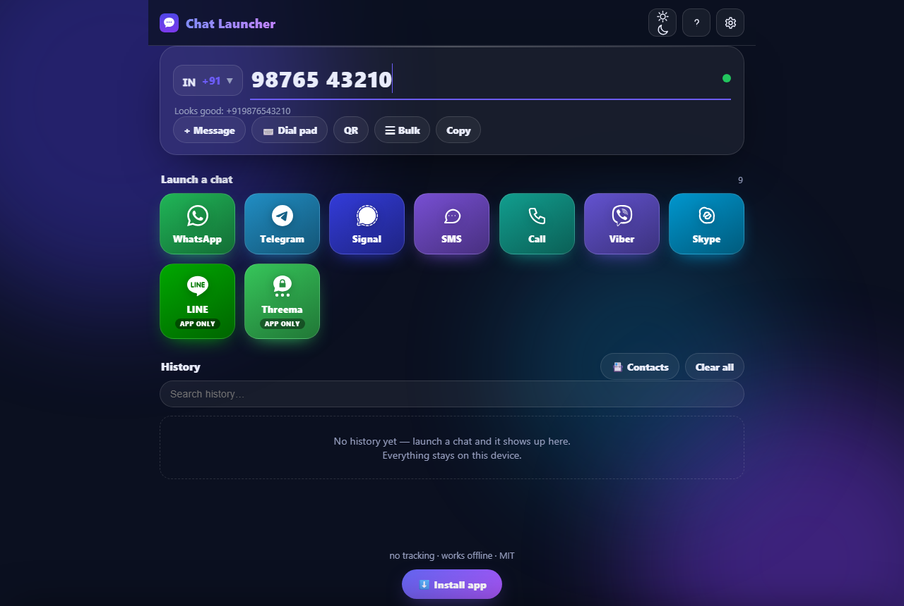
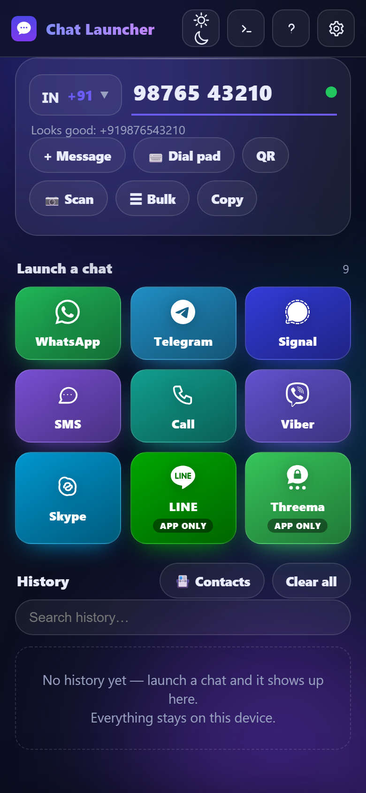

# 💬 Chat Launcher

**Type a phone number → tap an app → start chatting.**

Chat Launcher opens a number's chat directly in WhatsApp, Telegram, Signal, SMS, Viber, Skype and more — no contacts app, no copy-pasting, no saving the number first. It's a zero-dependency, offline-first PWA: nothing is tracked, nothing leaves your device, and it installs as a real app on Android, iOS and desktop.

<p align="center">
  
</p>
<p align="center">
  
</p>

## Why

Every messenger hides chat-by-number behind the same dance: save the contact, reopen the app, find them, chat — for a one-time conversation with a plumber or a marketplace seller. Chat Launcher collapses that to *number in, chat open*. It also shines when you already have a number in front of you (a listing, a support page, a message): paste `+91 98765 43210` and the country is detected automatically.

## Features

- 🚀 **9 launch targets** — WhatsApp, Telegram, Signal, SMS, Phone call, Viber, Skype, LINE, Threema
- 🌍 **Country picker** with ~230 dial codes and emoji flags; your choice is remembered
- 🧠 **Smart paste** — `+44 20 7946 0958`, `0049…`, `+1 (555) …` are parsed and matched to the country by longest prefix
- 🎯 **Country-aware formatting & validation** — numbers group as each country writes them (`98765 43210` in India, `555 123 4567` in the US) and are checked against the real numbering-plan length; unusual lengths ask before launching
- ✍️ **Preset message** — pre-fill text where the platform supports it (WhatsApp, SMS)
- 🕘 **History** — usage counts, pins, rename, free-text notes, per-entry default messenger, and search (number, label, note or app name)
- 📇 **Contact import** — a native picker in the Android shell, plus `.vcf` file import with drag & drop on desktop
- 📷 **QR share** — scannable code for the current number, so desktop → phone handoff is one scan
- 🧨 **Bulk launch** — paste a list of numbers, open them one by one or all at once
- 📦 **Backup & restore** — export/import history, settings and stats as a validated JSON file
- 📴 **Offline queue** — numbers shared in while offline wait for connectivity, then launch with one tap
- 💬 **Open in the native app** — on desktop, right-click the WhatsApp/Telegram tile to launch the installed client instead of the web
- ⌨️ **Dial-pad mode** and **keyboard shortcuts** — `Enter` launch, `Ctrl+1–9` app picker, `/` focus, `d` dial pad, `t` theme, `?` help
- 🌗 **Dark / light / system theme**, four accent presets plus a custom color picker
- 🌐 **Seven UI languages** — English, हिन्दी, Español, العربية (RTL), मराठी, বাংলা, தமிழ்
- 📊 **Local-only usage dashboard** — chats launched all-time and this month, top apps, on-device only
- 🛟 **Error boundary** — unexpected failures surface a toast with a reload action instead of a dead page
- 📲 **Installable PWA** — service-worker precache, offline from second visit, update toast, share-target support
- 🔗 **Deep links** — `?number=+15551234567&text=hi&app=whatsapp` opens pre-filled
- 🤖 **Android shell extras** — contact picker and history-driven dynamic launcher shortcuts
- 🖥️ **Desktop shell** — Tauri scaffold (`desktop/`) with a global-hotkey launcher window
- ♿ **Accessible** — labeled dialogs, keyboard navigable, aria-live validation, `prefers-reduced-motion` honoured
- 🧪 **Verified on every push** — 71 unit/property tests, 9 adversarial security probes, 11 e2e journeys, bundle-size budget, F-Droid metadata lint, Lighthouse budget

## Platform support

| Target | Opens chat by number | Pre-filled message | Deep link |
|---|---|---|---|
| WhatsApp | ✅ | ✅ | `https://wa.me/<number>?text=…` |
| Telegram | ✅ | — | `https://t.me/+<number>` |
| Signal | ✅ | — | `https://signal.me/#p/+<number>` |
| SMS | ✅ | ✅ | `sms:+<number>?body=…` (iOS: `&body=`) |
| Phone call | ✅ | — | `tel:+<number>` |
| Viber | ✅ | — | `viber://chat?number=%2B…` |
| Skype | ✅ | — | `skype:+<number>?chat` |
| LINE | ⚠️ app only | — | `line://` |
| Threema | ⚠️ app only | — | `threema://` |

*App only* = the platform exposes no open-chat-by-phone-number URL, so the tile opens the app itself. This is a platform limitation, not a bug — it's labeled honestly in the UI too.

## Privacy

- **No network requests after load.** The app is a static shell; the only outbound navigation is the deep link you tap.
- **No accounts, no analytics, no tracking** — enforced by the Content-Security-Policy (`connect-src 'none'`).
- **All data stays on your device** in `localStorage` (history, settings). "Wipe all local data" in settings removes everything.
- Referrer is stripped (`no-referrer`) so chat targets don't learn you came from Chat Launcher.

## Install as an app

- **Android (Chrome/Edge):** open the site → menu ⋮ → *Add to Home screen* / *Install app*
- **iOS (Safari):** Share → *Add to Home Screen*
- **Desktop (Chrome/Edge):** install icon in the address bar, or the in-app *Install* button
- **Android APK:** a small Expo shell around this site is built on [Expo EAS](https://expo.dev) and attached to [Releases](../../releases) — it loads the live app, keeps everything up to date, and hands deep links (`wa.me`, `tel:`, …) to the operating system

## Run locally

```bash
node tools/serve.mjs        # → http://127.0.0.1:8143
```

Requires only Node.js (any recent version). No build step, no dependencies.

## Tests

```bash
npm test                    # unit + property-based tests
node tools/serve.mjs &      # then, optionally:
node tools/bug-hunt.mjs     # adversarial probes against a real browser
node tools/e2e.mjs          # happy-path user journeys
node tools/bundle-budget.mjs
node tools/fdroid-lint.mjs
```

71 tests cover phone normalization (E.164, trunk zeros, paste parsing, per-country lengths and grouping), every platform's deep-link shape, exactly-once message encoding, history (dedup, pins, notes, last-app, capacity, corrupt-JSON recovery), stats, backups (round-trip + hostile imports), vCard parsing, the offline queue, color math, and i18n completeness across all seven languages — plus seeded property tests that fuzz ~1,700 generated inputs. 9 adversarial probes drive the app with hostile inputs (XSS payloads, poisoned storage, CSP checks); 11 e2e journeys exercise launch, search, i18n/RTL, export/import, contact import, the unusual-length confirm and dialog accessibility.

## Repo layout

| Path | What |
|---|---|
| `js/`, `css/`, `index.html` | the PWA — everything ships from the repo root (GitHub Pages) |
| `tests/` | unit + property tests (`node --test`) |
| `tools/` | dev tooling: server, screenshots, bug-hunt, e2e, budgets, f-droid lint |
| `expo-app/` | Android shell (Expo): WebView host, contact picker, dynamic shortcuts |
| `desktop/` | Tauri desktop shell scaffold (global hotkey launcher) |
| `fdroid/` | F-Droid metadata + submission notes |
| `docs/` | security audit report |

## Tech notes

- **Zero dependencies, zero build** — vanilla ES modules; icons are generated PNGs/SVG committed to the repo (`node tools/gen-icons.mjs` regenerates them)
- **CSP-hardened** — `script-src 'self'`, `connect-src 'none'`, `form-action 'none'`
- **60 fps animations** — transforms/opacity only; drifting gradient orbs, staggered tiles, ripple ink, particle burst
- Numbers are normalized to [E.164](https://www.itu.int/rec/T-REC-E.164) before link construction; see [CONTEXT.md](CONTEXT.md) for the domain vocabulary
- **Android shell** (`expo-app/`) is a minimal React Native WebView container built with EAS — it contributes no UI of its own, only a floating contact-picker button and history-driven launcher shortcuts
- **Desktop shell** (`desktop/`) is a Tauri v2 window with a `Ctrl+Shift+C` global hotkey; build it with the Rust toolchain (see `desktop/README.md`)
- **Distribution** — GitHub Pages (web), GitHub Releases (APK), F-Droid metadata for a self-hosted repo or an fdroiddata merge request

## Acknowledgments

- Brand glyphs (WhatsApp, Telegram, Signal, Viber, LINE, Threema) come from [Simple Icons](https://simpleicons.org) (CC0 path data). All marks are trademarks of their respective owners — Chat Launcher is not affiliated with any of them. Skype's brand was retired in 2025, so it keeps a generic glyph.
- Country calling codes compiled from the ITU E.164 allocation list

## License

[MIT](LICENSE)
