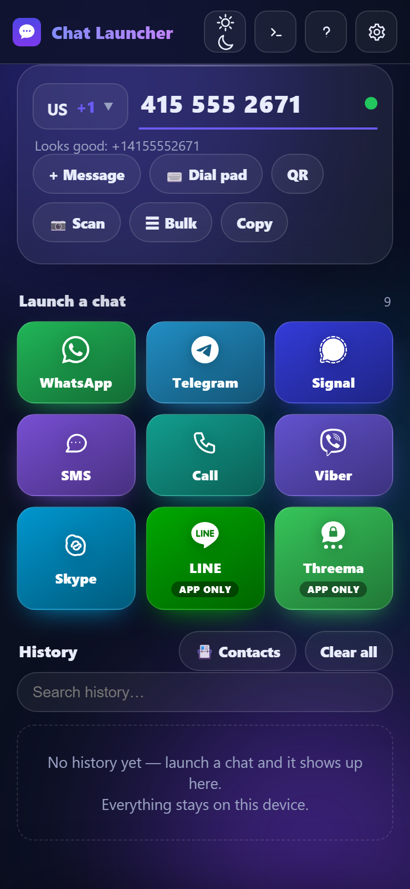
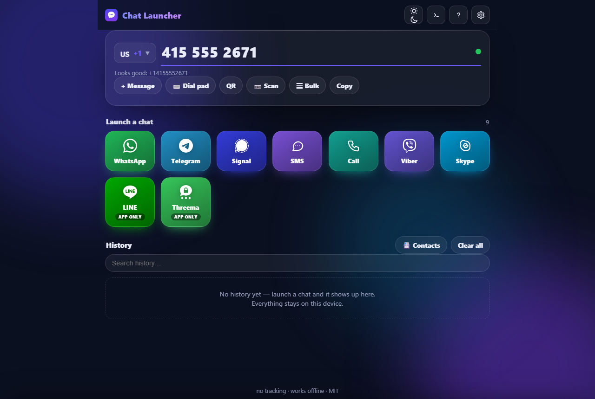

<div align="center">

<h1>Chat Launcher</h1>

<p><strong>Enter a phone number, choose a messenger and start chatting.</strong></p>

<p><strong><a href="https://avithegod2010.github.io/chat-launcher/">💬 Open Chat Launcher</a></strong> · <a href="#install">⬇️ Install on Android or Windows</a> · <a href="#privacy">🔒 Privacy</a></p>

</div>

## 💬 Phone and desktop

<p align="center">
  <a href="screenshots/mobile-dark.png"></a>
  <a href="screenshots/desktop-dark.png"></a>
</p>

<details>
<summary>Project illustration</summary>

<picture>
  <source media="(prefers-reduced-motion: reduce)" srcset="readme-hero.png" />
  
</picture>

</details>

<p align="center"><sub>Enter a number → choose a messenger → open the conversation</sub></p>

## Why

Paste or type a number and Chat Launcher detects the country from its dial code. Open WhatsApp, Telegram, Signal, SMS or another supported app without adding the number to your contacts.

<a name="features"></a>

## ✨ Features

- 🚀 **9 launch targets** — WhatsApp, Telegram, Signal, SMS, Phone call, Viber, Skype, LINE, Threema
- 🌍 **Country picker** with ~230 dial codes and emoji flags; your choice is remembered
- 🧠 **Smart paste** — `+44 20 7946 0958`, `0049…`, `+1 (555) …` are parsed and matched to the country by longest prefix
- 🎯 **Country-aware formatting & validation** — numbers group as each country writes them (`98765 43210` in India, `555 123 4567` in the US) and are checked against the real numbering-plan length; unusual lengths ask before launching
- ✍️ **Preset message & templates** — pre-fill text, or keep reusable templates with `{name} {number} {app} {date} {time}` variables
- 🕘 **History** — usage counts, pins, rename, free-text notes, **contact avatars**, per-entry default messenger, and search (number, label, note or app name)
- ✦ **Smart suggestion** — the tile you'd most likely use is highlighted from per-number history, global usage and time-of-day
- 📷 **QR share + scanner** — generate a code for the current number, or scan a QR/MeCard/barcode with the camera to fill it in
- 📢 **Broadcast lists** — named groups of numbers, CSV import/export, launch the whole list on any target
- 🧨 **Bulk launch** — paste a list of numbers, open them one by one or all at once
- 🔐 **End-to-end encrypted sync** — one passphrase → AES-GCM; push/pull to *your own* WebDAV server (Nextcloud works), or let it **auto-sync once per launch**; the server only ever sees ciphertext
- ⌨️ **Command palette** — `Ctrl/⌘+K` for every action: launch apps, switch language/theme, run history entries
- ⏰ **Scheduled chats** (Android shell) — a notification at your chosen time opens the chat
- 📴 **Offline queue** — numbers shared in while offline wait for connectivity, then launch with one tap
- 💬 **Open in the native app** — on desktop, right-click the WhatsApp/Telegram tile to launch the installed client instead of the web
- ⌨️ **Dial-pad mode** and **keyboard shortcuts** — `Enter` launch, `Ctrl+1–9` app picker, `/` focus, `d` dial pad, `t` theme, `?` help
- 🌗 **Dark / light / system theme**, four accent presets, custom color picker, **large-text mode** and **high-contrast surfaces**
- 🌐 **Twelve UI languages** — English, हिन्दी, Español, العربية (RTL), मराठी, বাংলা, தமிழ், Deutsch, Français, Português, Русский, 日本語
- 📊 **Local-only usage dashboard** — chats launched all-time and this month, top apps, on-device only
- 🛟 **Error boundary** — unexpected failures surface a toast with a reload action instead of a dead page
- 📲 **Installable PWA** — service-worker precache, offline from second visit, update toast, share-target support
- 🔗 **Deep links** — `?number=+15551234567&text=hi&app=whatsapp` opens pre-filled
- 🤖 **Android shell extras** — contact picker (with photos), history-driven launcher shortcuts, **home-screen widget**, **Quick Settings tile**, **share-in from any app**, scheduled-chat notifications
- 🧩 **Browser extension** (`extension/`) — select or right-click any number on any page to launch it
- 🖥️ **Desktop shell** — Tauri app (`desktop/`) with global hotkey, **tray icon** and a **clipboard watcher** (copy a number anywhere → launcher opens)
- ♿ **Accessible** — labeled dialogs, keyboard navigable, aria-live validation, `prefers-reduced-motion` honoured, motion tokens + View Transitions
- 🧪 **Verified on every push** — 104 unit/property tests, 11 adversarial security probes, 17 e2e journeys, bundle-size budget, F-Droid metadata lint, Lighthouse budget

## Platform support

| Target | Opens chat by number | Pre-filled message | Deep link |
|---|---|---|---|
| WhatsApp | ✅ | ✅ | `https://wa.me/<number>?text=…` |
| Telegram | ✅ | — | `https://t.me/+<number>` |
| Signal | ✅ | — | `https://signal.me/#p/+<number>` |
| SMS | ✅ | ✅ | `sms:+<number>?body=…` (iOS: `&body=`) |
| Phone call | ✅ | — | `tel:+<number>` |
| Viber | ✅ | — | `viber://chat?number=%2B…` |
| Skype | ✅ | — | `skype:+<number>?chat` |
| LINE | ⚠️ app only | — | `line://` |
| Threema | ⚠️ app only | — | `threema://` |

*App only* = the platform exposes no open-chat-by-phone-number URL, so the tile opens the app itself. This is a platform limitation, not a bug — it's labeled honestly in the UI too.

<a name="privacy"></a>

## 🔒 Privacy

- **No network requests after load** — until *you* configure sync. The CSP allows outbound requests only to https endpoints, and the app itself fetches nothing.
- **No accounts, no analytics, no tracking.**
- **All data stays on your device** in `localStorage` (history, settings). "Wipe all local data" in settings removes everything.
- **Sync is zero-knowledge**: your passphrase derives the AES-GCM key on-device (PBKDF2, 310k iterations); the WebDAV server only ever stores ciphertext. WebDAV credentials are stored locally in `localStorage` — use an app password.
- Referrer is stripped (`no-referrer`) so chat targets don't learn you came from Chat Launcher.

<a name="install"></a>

## ⬇️ Install

| Platform | Download |
| --- | --- |
| Android | [APK v2.0.2](https://github.com/Avithegod2010/chat-launcher/releases/download/v2.0.2/app-release.apk) |
| Windows | [Installer v2.1.0](https://github.com/Avithegod2010/chat-launcher/releases/download/desktop-v2.1.0/chat-launcher-setup.exe) · [Portable EXE](https://github.com/Avithegod2010/chat-launcher/releases/download/desktop-v2.1.0/chat-launcher-desktop.exe) |

### Install from your browser

- **Android (Chrome/Edge):** open the site → menu ⋮ → *Add to Home screen* / *Install app*
- **iOS (Safari):** Share → *Add to Home Screen*
- **Desktop (Chrome/Edge):** install icon in the address bar, or the in-app *Install* button
- **Windows desktop shell:** portable exe and NSIS installer attached to the [`desktop-v*` releases](../../releases) (Tauri, ~2 MB; global hotkey + clipboard watcher)
- **Android APK:** a small Expo shell around this site is built on [Expo EAS](https://expo.dev) and attached to [Releases](../../releases) — it loads the live app, keeps everything up to date, and hands deep links (`wa.me`, `tel:`, …) to the operating system

<a name="run-locally"></a>

## 🛠️ Run locally

```bash
node tools/serve.mjs        # → http://127.0.0.1:8143
```

Requires only Node.js (any recent version). No build step, no dependencies.

## Tests

```bash
npm test                    # unit + property-based tests
node tools/serve.mjs &      # then, optionally:
node tools/bug-hunt.mjs     # adversarial probes against a real browser
node tools/e2e.mjs          # happy-path user journeys
node tools/bundle-budget.mjs
node tools/fdroid-lint.mjs
```

109 tests cover phone normalization (E.164, trunk zeros, paste parsing, per-country lengths and grouping), every platform's deep-link shape, exactly-once message encoding, history (dedup, pins, notes, last-app, capacity, corrupt-JSON recovery), stats (incl. hour-of-day buckets), backups (round-trip + hostile imports), vCard parsing, the offline queue, color math, **message templates, broadcast lists + CSV, the suggestion engine, the E2E sync crypto (round-trip, tamper, wrong passphrase, WebDAV stubs) including the two-way auto-sync pass, and i18n completeness across all twelve languages** — plus seeded property tests that fuzz ~1,700 generated inputs. 11 adversarial probes drive the app with hostile inputs (XSS payloads, poisoned storage, CSP checks, hostile palette labels, shell-bridge message floods); 17 e2e journeys exercise launch, search, i18n/RTL, export/import, contact import, the unusual-length confirm, dialog accessibility, the command palette, templates, broadcast lists, the scanner, large-text/contrast modes and the suggestion badge.

## Repo layout

| Path | What |
|---|---|
| `js/`, `css/`, `index.html` | the PWA — everything ships from the repo root (GitHub Pages) |
| `tests/` | unit + property tests (`node --test`) |
| `tools/` | dev tooling: server, screenshots, bug-hunt, e2e, budgets, f-droid lint, extension packer |
| `expo-app/` | Android shell (Expo): WebView host, contact picker, shortcuts, widget, tile, share-in, scheduled notifications |
| `extension/` | browser extension (MV3): selection pill + context-menu launcher |
| `desktop/` | Tauri desktop shell: global hotkey, tray, clipboard watcher |
| `fastlane/` | Play Store upload lanes + store metadata |
| `fdroid/` | F-Droid metadata + submission notes |
| `docs/` | security audit report |

## Tech notes

- **Zero dependencies, zero build** — vanilla ES modules; icons are generated PNGs/SVG committed to the repo (`node tools/gen-icons.mjs` regenerates them)
- **CSP-hardened** — `script-src 'self'`, `form-action 'none'`; `connect-src 'self' https:` exists *only* so the optional, user-configured sync can reach your own server — the app itself still fetches nothing
- **60 fps animations** — motion tokens drive transforms/opacity only; drifting gradient orbs, staggered tiles, ripple ink, particle burst, View Transitions on theme/language changes
- Numbers are normalized to [E.164](https://www.itu.int/rec/T-REC-E.164) before link construction; see [CONTEXT.md](CONTEXT.md) for the domain vocabulary
- **Android shell** (`expo-app/`) is a minimal React Native WebView container built with EAS — it contributes no UI of its own, only a floating contact-picker button and history-driven launcher shortcuts
- **Desktop shell** (`desktop/`) is a Tauri v2 window with a `Ctrl+Shift+C` global hotkey; build it with the Rust toolchain (see `desktop/README.md`)
- **Distribution** — GitHub Pages (web), GitHub Releases (APK), a self-hosted signed F-Droid repo at `.../fdroid/repo` (see [`docs/FDROID-REPO.md`](docs/FDROID-REPO.md)), and fdroiddata metadata for an official F-Droid merge request

## Acknowledgments

- Brand glyphs (WhatsApp, Telegram, Signal, Viber, LINE, Threema) come from [Simple Icons](https://simpleicons.org) (CC0 path data). All marks are trademarks of their respective owners — Chat Launcher is not affiliated with any of them. Skype's brand was retired in 2025, so it keeps a generic glyph.
- Country calling codes compiled from the ITU E.164 allocation list

## License

[MIT](LICENSE)
